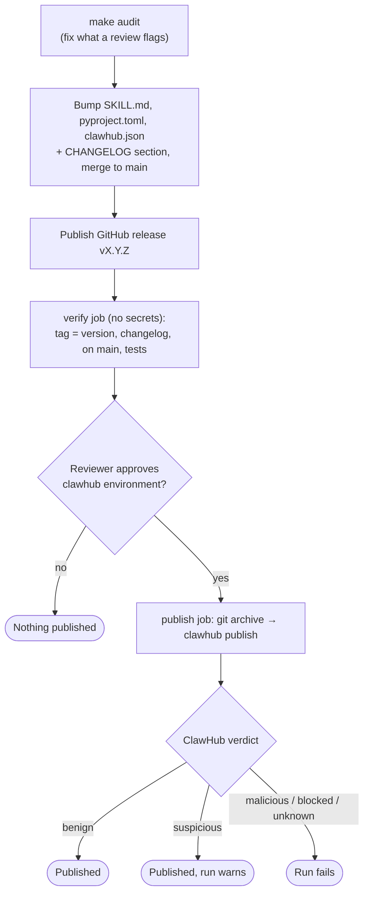

# Contributing to Apple Music DJ

Thanks for your interest in contributing! Here's how to get started.

## Quick start

```bash
git clone https://github.com/<you>/apple-music-dj && cd apple-music-dj
make setup                         # .venv, dev tools, git hooks; checks bash, curl and jq
. .venv/bin/activate
python3 scripts/demo.py tour       # see what it does, no account or tokens needed
make ci                            # everything CI checks; `make help` lists the other targets
```

Then make your change on a branch and open a PR. Commit messages follow
[Conventional Commits](https://www.conventionalcommits.org/) (`feat:`, `fix:`, `docs:` …); the git hook checks this
as you commit. `make ci` also needs actionlint (`brew install actionlint`). The sections below have the detail.

## Getting Started

1. Fork the repo and clone your fork
2. Set up: `make setup` creates `.venv`, installs the dev tools (pytest, pytest-cov, pytest-xdist, ruff, mypy,
   ShellCheck, pre-commit, pyyaml), installs the git hooks and checks that `bash`, `curl` and `jq` are installed.
   Then `. .venv/bin/activate`
3. Try it with no account: `python3 scripts/demo.py tour`, then `make ci` (everything CI checks)

You don't need an Apple Developer account to contribute: the test suite and the demo run the real
scripts against a local mock of the API (see [Testing without an Apple Developer account](#testing-without-an-apple-developer-account)).
To try changes on your own library as well, run `python3 scripts/setup_auth.py` (or copy
`.env.example` to `.env` and fill in your tokens) and check with `scripts/verify_setup.sh`.

## Development

### Prerequisites

- macOS or Linux
- `curl`, `jq`, `python3` installed
- For live testing only: Apple Developer Program membership (for MusicKit tokens) and an active
  Apple Music subscription

### Project Structure

- `SKILL.md` — Skill definition (frontmatter + workflows). This is what OpenClaw reads.
- `scripts/` — All executable scripts (Bash + Python)
- `references/` — Deep reference docs for auth, API, and strategies
- `assets/` — Skill icon and visual assets

### Code Style

**Bash:**

- Use `set -euo pipefail` at the top of every script
- Quote all variables: `"$var"` not `$var`
- Use `[[ ]]` for conditionals
- Functions use `snake_case`

**Python:**

- Python 3.11+ (CI tests 3.11 through 3.15 on Linux, and 3.14 on macOS)
- No pip dependencies for core scripts (stdlib only)
- `PyJWT` is the only exception (for token generation)
- Functions use `snake_case`, classes use `PascalCase`
- Run tests before submitting: `python3 -m pytest tests/ -v`
- One-time setup: `make setup` (it installs the dev extra and the `pre-commit` hooks, so ruff, ShellCheck and the
  conventional-commit check run on every commit; by hand: `pip install -e ".[dev]"` then `pre-commit install
  --hook-type pre-commit --hook-type commit-msg`). `make ci` also needs actionlint (`brew install actionlint`)
- Before submitting: `make ci` runs everything CI checks (ruff, ShellCheck, mypy, tests with the 90% coverage
  floor, actionlint); `make ruff` is the quick lint-only run

### Testing Changes

```bash
make ci                                   # what CI runs; `make lint` is a quick syntax check
make test-fast                            # just the tests, in parallel on every core

# Run any script against the mock API, no tokens needed
python3 scripts/demo.py run strategy_engine.py --profile DEMO_PROFILE --storefront us --strategy similar --similar-to Radiohead
```

With your own tokens (live API):

```bash
scripts/apple_music_api.sh verify                                  # API connectivity
python3 scripts/taste_profiler.py --cache /tmp/test_profile.json  # a real taste profile
```

CI picks what to run from the files a PR changes. A PR that only touches docs (`*.md`, `assets/`,
`LICENSE`, issue templates) runs just the tests that read docs and assets, on one Python version.
Anything else runs lint and the full matrix. The **CI result** check sums it up either way, and it's
the one to require in branch protection.

### Testing without an Apple Developer account

`scripts/demo.py` is a local stand-in for the Apple Music API (it also powers the user-facing demo
mode, so it ships with the skill; `tests/mock_api.py` re-exports it), and
`tests/test_integration_mock_api.py` runs the real scripts (curl, jq and all) against it.
It runs as part of `pytest`. The quickest look is `python3 scripts/demo.py tour`; to poke at the
API by hand:

```bash
python3 scripts/demo.py serve &                   # serves http://127.0.0.1:8765
export APPLE_MUSIC_API_BASE=http://127.0.0.1:8765  # loopback addresses only
export APPLE_MUSIC_DEV_TOKEN=x APPLE_MUSIC_USER_TOKEN=y
scripts/apple_music_api.sh recently-added 5
```

The mock's response shapes follow Apple's docs but are not verified against the real
service, so it complements a live run rather than replacing one.

### Regenerating the README demo

`assets/demo-tour.svg` is an animated replay of `scripts/demo.py tour`. When the tour's output
changes, run `make demo-svg` and commit the result (`tests/test_demo_assets.py` checks it is valid and
has the real scenes).

## Publishing to ClawHub

Maintainers only. Releases are published by CI; the manual route below is the fallback.

### Automated (preferred)

`.github/workflows/publish-clawhub.yml` publishes when you **publish a GitHub release**:



0. **Run `make audit` first.** ClawHub's reviewer sees only the published files (not `tests/` or this
   changelog), and its verdict has flipped on identical code, so fix what it could flag before
   publishing. The command runs the trust-claim, listing and packaging checks, lists the shipped
   files that changed since the last tag, and prints a review prompt. Give the prompt and the diff
   (`make audit` explains how; `--full` embeds it) to a model or a second pair of eyes, and fix
   what comes back.
1. Bump the version in `SKILL.md`, `pyproject.toml` and `clawhub.json` (they must agree), add a
   `## [X.Y.Z]` section to `CHANGELOG.md`, and merge to `main`.
2. Publish a GitHub release tagged `vX.Y.Z` on that commit.
3. The **verify** job (no secrets) checks that the tag matches the version, the changelog section
   exists, the commit is on `main`, and the tests pass.
4. The **publish** job then waits for a required reviewer to approve the `clawhub` Environment.
   Approving is the real decision: publishing accepts ClawHub's **MIT-0** license terms
   automatically (the CLI sends `acceptLicenseTerms: true`). The repo is MIT-0 too, so the two match.
5. It publishes a clean `git archive` of the release commit, waits for ClawHub's scans to finish,
   and reports ClawHub's verdict. A **malicious** or **blocked** verdict (or one it can't recognize, or any
   unexpected verification reason) fails the run.
   A **suspicious** verdict only produces a warning with the reviewer's summary: ClawHub's LLM review
   is not stable (identical code has flipped between benign and suspicious on re-scans), and the
   version is already published, so a red run would change nothing on the registry. Read the audit
   page when you see the warning. The skill card is generated asynchronously (sometimes 30+ minutes
   later), so a missing card is a warning too; check `clawhub skill verify apple-music-dj` later.

Run the workflow manually from the Actions tab for a **dry run** (the default): it does every check
and `clawhub publish --dry-run`, and publishes nothing.

One-time setup (repo **Settings -> Environments**): an environment named `clawhub` with a required
reviewer, holding a `CLAWHUB_TOKEN` secret — e.g. `clawhub token | gh secret set CLAWHUB_TOKEN --env clawhub`.
The token grants publish rights on the account, so it only exists in that environment (never as a
repo-wide secret) and is written to a private temp file, never passed on a command line. Skills have
no trusted-publisher (OIDC) option in the CLI, so a stored token is unavoidable.

### Manual fallback

- Use a **recent CLI** (`pnpm add -g clawhub@latest`; 0.7.0's fixed 15 s request timeout can't upload
  this skill). Check you're logged in with `clawhub whoami`.
- **The CLI reads `.clawhubignore`, not `.clawignore`.** Both files exist and must stay identical
  (`tests/test_packaging.py` enforces it); otherwise tests and dev files get uploaded.
- **Publish from a clean export of the reviewed commit**, not your working folder (local `.venv`,
  caches and untracked files would otherwise be eligible):
  ```bash
  git fetch origin main
  SHA=$(git rev-parse origin/main)   # the reviewed, merged commit — not whatever your local branch has
  rm -rf /tmp/amdj && mkdir -p /tmp/amdj && git archive "$SHA" | tar -x -C /tmp/amdj
  clawhub publish /tmp/amdj --slug apple-music-dj --name "Apple Music DJ" --version X.Y.Z \
    --source-repo and3rn3t/apple-music-dj --source-commit "$SHA" --source-ref main \
    --changelog "..."
  ```
  Use the same `$SHA` for the archive and `--source-commit`: `git checkout main && git pull` is not
  enough, because a locally-ahead or divergent `main` would publish unreviewed commits.
  `--dry-run` previews without publishing.

### After publishing

The new version appears as `latest` only after ClawHub's security scans finish (a few minutes);
`clawhub inspect apple-music-dj` shows it, and the audit is at
`clawhub.ai/<owner>/skills/apple-music-dj/security-audit`. The skill card is generated by ClawHub
(the CLI strips any uploaded `skill-card.md`), so there is nothing to author.

Keep example commands in `SKILL.md` free of flag names that read like secrets (an earlier
`--seed "<value>"` example was flagged as a crypto seed phrase on the command line).

## Making Changes

1. Create a feature branch: `git checkout -b feature/my-change`
2. Make your changes
3. Run syntax checks (see above)
4. Test with a real Apple Music account if possible
5. Update `CHANGELOG.md` under `[Unreleased]`
6. Update `SKILL.md` if you add triggers, commands, or scripts
7. Submit a pull request

## Adding a New Feature

If you're adding a new engagement feature or playlist strategy:

1. Create the script in `scripts/`
2. Add a short feature section to `SKILL.md` (triggers, run command, safety rules) and the longer
   description to `references/features.md`; SKILL.md's body stays under 500 lines
3. Add the script to the Scripts table in `SKILL.md`
4. Add a Quick Commands entry in `SKILL.md`
5. Add an example to `references/examples.md`
6. Update `README.md` features list, file structure, and examples
7. If it's a playlist strategy, add the algorithm to `references/playlist-strategies.md`
8. Update `CHANGELOG.md`

## Reporting Issues

- Include your OS, Python version, and OpenClaw version
- Include the full error output
- Redact your tokens! Never paste `APPLE_MUSIC_DEV_TOKEN` or `APPLE_MUSIC_USER_TOKEN`

## License

By contributing, you agree that your contributions will be licensed under the MIT No Attribution License (MIT-0).
