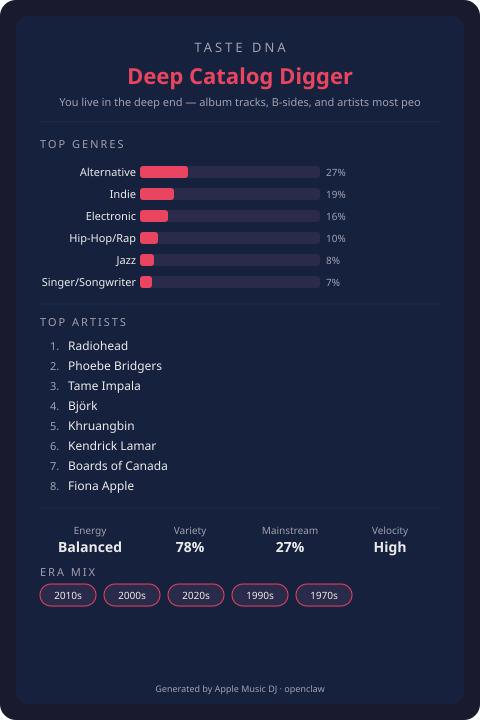

# 🎧 Apple Music DJ

[](https://github.com/and3rn3t/apple-music-dj/actions/workflows/test.yml)


[](LICENSE)

**Your AI-powered Apple Music curator.** Analyzes your listening history, understands your taste DNA, and creates intelligent playlists directly in your Apple Music library — on all your devices.

Built as an [OpenClaw](https://openclaw.ai) skill, on [ClawHub](https://clawhub.ai). Talk naturally, get playlists.

**No Apple Developer account yet?** Try it in 30 seconds with the built-in demo: [`python3 scripts/demo.py tour`](#-try-it-first-no-account-needed).

---

## ✨ Features

- **🧬 Taste DNA Profiling** — Deep analysis of your listening from recently played, heavy rotation, library, ratings, recommendations, and Apple Music Replay
- **🧪 Demo mode** — Try every feature against a fictional listener, no tokens needed
- **🔑 One-step setup** — `setup_auth.py` signs your developer token and gets your user token from a browser sign-in
- **🎵 8 Playlist Strategies** — Deep cuts, mood/activity, trend radar, constellation discovery, playlist refresh, **songs-like-X seed**, **decade throwbacks**, and **two-person blends**
- **🌊 Energy-arc sequencing** — Playlists build, peak and wind down (or rise/fall for workouts and sleep) instead of just spacing artists out
- **📈 Taste Drift** — Dated snapshots show how your genres, artists and listener archetype change over time
- **📥 Playlist Import** — Rebuild a Spotify (CSV) or plain-text playlist in Apple Music, matched by ISRC
- **👍 Feedback loop** — "I didn't like track 7" rates the song down and keeps it out of future playlists
- **🃏 Taste DNA Card** — Shareable visual summary of your listener identity
- **🎯 Compatibility Scoring** — How well does your taste match an artist (or another listener)?
- **📊 Listening Insights** — Timeline, streaks, milestones, year-in-review
- **🔍 Catalog Gap Analysis** — Find albums you're missing from artists you love
- **💿 Album Deep Dive** — Track-by-track breakdown with context
- **🐇 Artist Rabbit Hole** — Chain exploration from familiar artists into new territory
- **🎧 Daily Song Drop** — One perfect track per day with a reason why
- **⏰ What Should I Listen To Now?** — Context-aware instant picks
- **🎤 Concert Prep** — Setlist-ready playlists for upcoming shows
- **📡 New Release Radar** — Personalized scan of new releases
- **🤖 Cron Auto-Playlists** — Weekly discovery, daily drops, and new release watch on a schedule
- **📱 Direct Integration** — Playlists appear instantly in Apple Music on all your devices

## 📋 Requirements

| Requirement | Details |
|---|---|
| **Apple Developer Account** | [$99/year](https://developer.apple.com/programs/) — needed for MusicKit API access (not for the demo) |
| **Apple Music subscription** | Active subscription on your Apple ID (not for the demo) |
| **Python** | 3.10+ (no pip packages needed for core features; `PyJWT` + `cryptography` only to sign a developer token) |
| **OpenClaw** | [openclaw.ai](https://openclaw.ai) · [docs](https://docs.openclaw.ai) |
| **CLI tools** | `curl`, `jq` (usually pre-installed on macOS) |

## 🚀 Quick Install

```bash
# From ClawHub (recommended)
openclaw skills install apple-music-dj

# Or clone directly
git clone https://github.com/and3rn3t/apple-music-dj.git ~/.openclaw/workspace/skills/apple-music-dj
```

Start a new OpenClaw session afterwards so the skill loads. It loads even before you've set up
any tokens, so you can ask it for the demo first; anything that reads your own music asks for the
tokens when it needs them.

## 🧪 Try it first (no account needed)

```bash
python3 scripts/demo.py tour
```

Runs the real scripts against a fictional listener and a small sample catalog served on `127.0.0.1`:
a Taste DNA card, a "songs like Radiohead" playlist, a 90s throwback, a daily pick and a
compatibility score. Nothing is sent to Apple and nothing touches an account. Any script works the
same way, with `DEMO_PROFILE` standing in for the profile:

```bash
python3 scripts/demo.py run strategy_engine.py --strategy mood --mood focus --profile DEMO_PROFILE
```

Or just ask OpenClaw: *"Show me what the Apple Music DJ can do."*

## ⚡ 5 Minutes to First Playlist

### 1. Get your tokens (one command)

You need an Apple Developer account and a MusicKit key (`.p8`) — [`references/auth-setup.md`](references/auth-setup.md)
shows where to click. Then:

```bash
pip install PyJWT cryptography          # only needed to sign the developer token
python3 scripts/setup_auth.py --key-id ABC123DEFG --team-id XYZ987TEAM --key-path ~/AuthKey_ABC123DEFG.p8
```

It signs your developer token, opens a local page where you sign in with Apple, and prints the two
`export` lines (or writes them to an owner-only file with `--env-file`). Add them to your shell
profile, or to `~/.openclaw/openclaw.json` under `skills.entries."apple-music-dj".env`.

Tokens last about 6 months. `python3 scripts/setup_auth.py status` shows how long you have, and
the skill warns you two weeks ahead.

### 2. Verify setup

```bash
scripts/verify_setup.sh
```

### 3. Talk to your DJ

Open OpenClaw and say:

> "Analyze my Apple Music taste and make me a playlist"

That's it. Your taste profile is built, a playlist is generated, and it appears in Apple Music.

## 🔒 What it can change

Read-only by default. Every write to your account is opt-in and previewed first:

| Action | Needs | When |
|---|---|---|
| Read listening history, library, ratings | Your tokens | Every profile build |
| Create a playlist | `--create` | After you approve the preview |
| Add or remove tracks in an existing playlist | `--apply` / `--yes` | After you see the exact changes |
| Add albums to your library | `--add-missing N --yes` | Gap analysis, on request |
| Favorite / rate songs | `--favorite`, `feedback.py … --yes` | Only when you say so |
| Scheduled jobs | `setup_cron.py install --confirm <digest>` | Report-only by default; `weekly-mix` is opt-in |

Data stays on your machine in `~/.apple-music-dj/` (owner-only). Full details: [`SECURITY.md`](SECURITY.md)
and the privacy section of [`SKILL.md`](SKILL.md).

## 🎛️ Available Commands

Just talk naturally. Here's what the DJ understands:

| You say... | What happens |
|---|---|
| "Analyze my taste" | Builds your Taste DNA profile |
| "Show my taste card" | Generates a shareable taste identity card |
| "Make me a workout playlist" | Mood/activity-matched playlist |
| "Find deep cuts from my favorites" | Hidden gems from artists you love |
| "What's trending that I'd like?" | Charts filtered through your taste |
| "Surprise me" | Constellation discovery — familiar → frontier |
| "Refresh my focus playlist" | Evolves an existing playlist with fresh tracks |
| "Songs like Phoebe Bridgers" | Seed strategy — similar artists, filtered through your taste |
| "Make me a 90s throwback" | Decade playlist built from your own artists |
| "Blend my taste with my sister's" | One playlist for two listeners (needs their profile JSON) |
| "How has my taste changed since spring?" | Taste drift report from your saved snapshots |
| "Import my Spotify playlist" | Previews matches first, then creates it |
| "I didn't like track 7" | Rates it down and updates your profile |
| "How compatible am I with Radiohead?" | Taste compatibility score |
| "What albums am I missing from Björk?" | Catalog gap analysis |
| "Tell me about In Rainbows" | Album deep dive |
| "Rabbit hole from Radiohead" | Artist chain exploration |
| "Give me one song for today" | Daily song drop |
| "What should I listen to right now?" | Context-aware instant pick |
| "I'm seeing Phoebe Bridgers next week" | Concert prep playlist |
| "Any new releases for me?" | Personalized new release scan |
| "How was my 2025 in music?" | Year-in-review analysis |
| "Set up weekly playlists" | Cron automation |
| "Show me what you can do" | Demo tour — no tokens needed |

## 📁 Project Structure

```
apple-music-dj/
├── SKILL.md                    # Full skill definition (triggers, workflows, phases)
├── README.md                   # This file
├── clawhub.json                # Package metadata
├── pyproject.toml              # Python project config
├── references/
│   ├── auth-setup.md           # Token setup walkthrough
│   ├── api-reference.md        # Apple Music API endpoint reference
│   ├── playlist-strategies.md  # Deep playbook for all 8 strategies
│   └── troubleshooting.md      # Step-by-step fixes for common issues
└── scripts/
    ├── _common.py              # Shared utilities (API, profile, token checks)
    ├── apple_music_api.sh      # Bash API wrapper (25+ commands, retry logic)
    ├── taste_profiler.py       # Taste DNA profiler with caching & Replay
    ├── build_playlist.sh       # Playlist creation & refresh with dedup
    ├── strategy_engine.py      # 8 playlist strategies + energy-arc sequencing
    ├── taste_card.py           # Shareable Taste DNA Card (SVG/text)
    ├── compatibility.py        # Taste compatibility scoring
    ├── listening_insights.py   # Timeline, streaks, year-in-review
    ├── catalog_explorer.py     # Gap analysis, album dive, rabbit hole
    ├── daily_pick.py           # Daily song drop & instant recommendation
    ├── playlist_history.py     # Playlist creation history tracking
    ├── playlist_health.py      # Playlist health check & maintenance
    ├── taste_drift.py          # Taste drift between dated snapshots
    ├── import_playlist.py      # CSV/text playlist import (ISRC + strict search)
    ├── feedback.py             # Like/dislike songs, update the profile
    ├── concert_prep.sh         # Concert prep playlist builder
    ├── new_releases.sh         # Personalized new release radar
    ├── generate_dev_token.py   # JWT generator (requires PyJWT)
    ├── setup_auth.py           # One-step token setup (browser sign-in) + status
    ├── demo.py                 # Demo mode: local sample catalog, no tokens
    ├── setup_cron.py           # Cron automation setup
    └── verify_setup.sh         # Setup verification checker
```

## 📸 Sample output

> The examples below use a **fictional listener profile** and a **small demo catalog** so you can see
> the shape of the results. Yours come from your own Apple Music data.

### Taste DNA Card



<details>
<summary>Text version (<code>taste_card.py --format text</code>)</summary>

```
╔══════════════════════════════════════╗
║          🎧  TASTE DNA CARD          ║
╠══════════════════════════════════════╣
  Archetype: Deep Catalog Digger
  You live in the deep end — album tracks, B-sides, and artists most people haven't heard of.

  ── TOP GENRES ──
  Alternative......... █████░░░░░░░░░░░░░░░ 27%
  Indie............... ███░░░░░░░░░░░░░░░░░ 19%
  Electronic.......... ███░░░░░░░░░░░░░░░░░ 16%
  Hip-Hop/Rap......... ██░░░░░░░░░░░░░░░░░░ 10%

  ── TOP ARTISTS ──
   1. Radiohead
   2. Phoebe Bridgers
   3. Tame Impala
   4. Björk

  ── STATS ──
  Energy:     Balanced
  Variety:    78%
  Mainstream: 27%
╚══════════════════════════════════════╝
```

</details>

### "Songs like Radiohead"

`strategy_engine.py --strategy similar --similar-to "Radiohead"` picks the artist's best songs plus
similar artists' top songs, then scores them against your own taste:

```
Like Radiohead · Oct 2026
 1. Starlight — Muse                   Fans of Radiohead tend to love Muse.
 2. Champagne Supernova — Oasis        Fans of Radiohead tend to love Oasis.
 3. Paranoid Android — Radiohead       One of Radiohead's best.
 4. Wonderwall — Oasis                 Fans of Radiohead tend to love Oasis.
 5. Supermassive Black Hole — Muse     Fans of Radiohead tend to love Muse.
```

### How has your taste changed?

Every fresh profile build saves a small dated snapshot; `taste_drift.py` compares two of them:

```
Taste drift: 2026-07-12 → 2026-10-11 (91 days)

Your taste moved toward Electronic (+10%) and away from Alternative (−7%). Khruangbin and 1 more
entered your top 20. You've gone from a Genre Drifter to a Deep Catalog Digger.

Rising:   Electronic +10%, Ambient +2%
Falling:  Alternative −7%, Singer/Songwriter −7%, Indie −3%
New top artists:     Khruangbin, Boards of Canada
Fell out of top 20:  Big Thief, Bon Iver
```

## 🔒 Privacy

All data stays on your machine. The skill reads your Apple Music listening data via the official API and caches it locally at `~/.apple-music-dj/`. Nothing is sent to third-party services. Tokens are read from environment variables and never logged; they are only written to disk if you ask `setup_auth.py --env-file` to (mode 600). For the renewal reminder the skill keeps a short fingerprint of the user token — never the token — and the date it first saw it. Taste drift keeps small dated snapshots (genre/artist/era weights, no song IDs) in `~/.apple-music-dj/snapshots/`. The skill only writes to your Apple Music account when you ask — creating playlists, adding missing albums, favoriting tracks, or rating songs — and the account-changing options (`--add-missing`, `--favorite`, feedback) are explicit.

## 🧪 Testing

```bash
make test              # Run all tests
make coverage          # Tests with coverage summary (fails below 80%)
make coverage-html     # Generate HTML coverage report
```

1,000+ tests across 22 modules — 91% coverage. Covers taste profiling, archetype detection, compatibility scoring, card generation, all eight strategies and energy-arc sequencing, taste drift, playlist import, feedback, playlist health, history tracking, cron setup, token generation and guided setup, demo mode, end-to-end runs against a local mock API, and shared utilities.

## 📖 Full Documentation

See [**SKILL.md**](SKILL.md) for the complete skill definition — triggers, workflows, all strategies, cron setup, error handling, and presentation guidelines.

## 🤝 Contributing

See [CONTRIBUTING.md](CONTRIBUTING.md) for development setup and guidelines.

## 📄 License

[MIT](LICENSE) — © 2026 Andernet (Matthew Anderson)

## 👤 Author

**Andernet** (Matthew Anderson) — [GitHub](https://github.com/and3rn3t)
