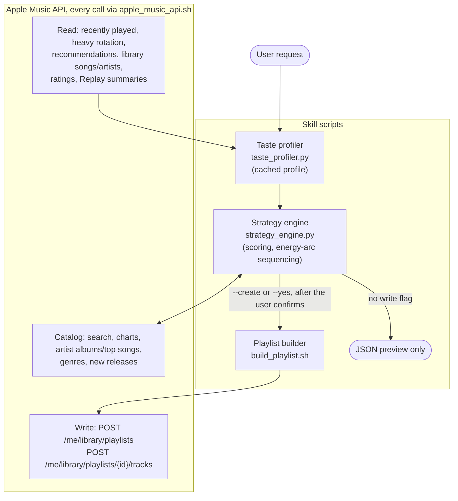

# Architecture

How a request flows through the skill's scripts and the Apple Music API.

- **Taste profiler** (`scripts/taste_profiler.py`) reads the user's listening and caches a profile.
- **Strategy engine** (`scripts/strategy_engine.py`) turns the profile plus catalog lookups into a sequenced track list.
- **Playlist builder** (`scripts/build_playlist.sh`) writes it to the library. Nothing is written without an
  explicit flag: `strategy_engine.py` creates a playlist only with `--create`, and `build_playlist.sh`
  (`create` / `refresh` / `remove`) writes only when `--yes` is its last argument.
- Every API call goes through `scripts/apple_music_api.sh` (see `api-reference.md`).

## What the taste profiler reads

Sources, strongest signal first:

| Source | Endpoint | Signal |
|---|---|---|
| Loved/disliked songs | `GET /v1/me/ratings/songs` | ★★★★★ Explicit intent |
| Heavy rotation | `GET /v1/me/history/heavy-rotation` | ★★★★☆ Repeated engagement |
| Recently played | `GET /v1/me/recent/played/tracks` | ★★★★☆ Current mood |
| Replay summaries | `GET /v1/me/music-summaries` | ★★★★☆ Annual deep data |
| Library songs | `GET /v1/me/library/songs?include=catalog` | ★★★☆☆ Broad taste |
| Library artists | `GET /v1/me/library/artists` | ★★★☆☆ Artist affinity |
| Recommendations | `GET /v1/me/recommendations` | ★★☆☆☆ Apple's inference |
