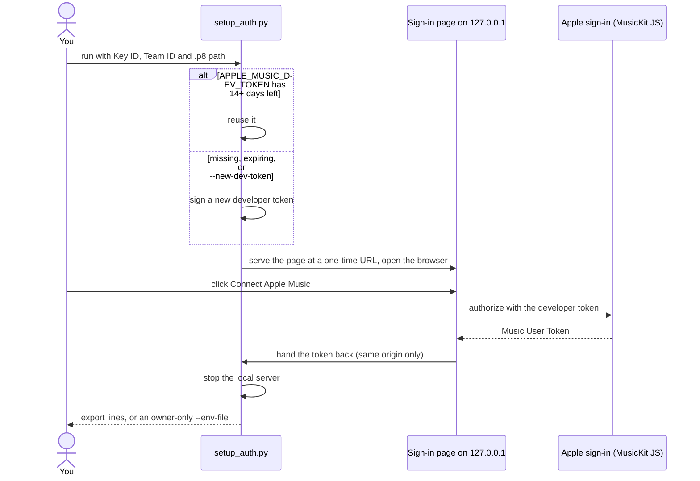

# Authentication Setup

## Overview

| Token | Env Variable | Lifetime | Refresh |
|---|---|---|---|
| Developer Token (JWT) | `APPLE_MUSIC_DEV_TOKEN` | Up to 6 months | Regenerate manually |
| Music User Token | `APPLE_MUSIC_USER_TOKEN` | ~6 months | No programmatic refresh — re-authorize in browser |

## Fast path

Do Steps 1–3 below once in the Apple Developer portal (account, MusicKit identifier, `.p8` key),
then let the setup script do the rest:

```bash
pip install PyJWT cryptography
python3 scripts/setup_auth.py --key-id YOUR_KEY_ID --team-id YOUR_TEAM_ID --key-path ~/AuthKey_XXXXXX.p8
```

It signs the developer token (Step 4), opens a page on `127.0.0.1` where you click **Connect
Apple Music** and sign in (Step 5), and prints both `export` lines. Options:

| Option | Does |
|---|---|
| `--env-file ~/.apple-music-dj-tokens.env` | Write the exports to an owner-only file instead of printing them; `source` it from your shell profile |
| `--no-browser` | Print the sign-in link instead of opening a browser |
| `--new-dev-token` | Sign a fresh developer token even if `APPLE_MUSIC_DEV_TOKEN` is still valid |
| `status` | Show how long each token has left |



The key details can also come from `APPLE_KEY_ID`, `APPLE_TEAM_ID` and `APPLE_PRIVATE_KEY_PATH`,
or the script asks for them. Run it in your own terminal, not through an agent, so your tokens
don't end up in a chat transcript.

**For OpenClaw**, put the tokens in your shell profile, or in `~/.openclaw/openclaw.json`:

```json
{ "skills": { "entries": { "apple-music-dj": { "env": {
  "APPLE_MUSIC_DEV_TOKEN": "eyJ…", "APPLE_MUSIC_USER_TOKEN": "…" } } } } }
```

(Sandboxed agents need them in the sandbox's env settings instead; see the OpenClaw skills docs.)

Just want to look around first? `python3 scripts/demo.py tour` needs no tokens at all.

The manual steps follow, for reference or if you'd rather do it by hand.

## Step 1: Apple Developer Account

You need an active Apple Developer Program membership ($99/year).
https://developer.apple.com/account

## Step 2: Create a MusicKit Identifier

1. Go to **Certificates, Identifiers & Profiles**
2. Under **Identifiers** → click **+** → select **Media IDs**
3. Name it (e.g., "Apple Music DJ"), check **MusicKit**, register

## Step 3: Generate a Private Key

1. Go to **Keys** → click **+**
2. Name it, check **Media Services (MusicKit)**
3. Register and **download the .p8 file** (one-time download)
4. Note your **Key ID** and **Team ID**

## Step 4: Generate the Developer Token

```bash
export APPLE_KEY_ID="YOUR_KEY_ID"
export APPLE_TEAM_ID="YOUR_TEAM_ID"
export APPLE_PRIVATE_KEY_PATH="/path/to/AuthKey_XXXXXX.p8"

# Requires: pip install PyJWT cryptography
python3 scripts/generate_dev_token.py
```

Then set the output:
```bash
export APPLE_MUSIC_DEV_TOKEN="eyJ..."
```

## Step 5: Obtain the Music User Token

`scripts/setup_auth.py` does this step for you. By hand: the user must sign in to Apple Music
in a browser. Create this HTML file and open it:

```html
<!DOCTYPE html>
<html>
<head><title>Apple Music Auth</title></head>
<body>
  <h1>Apple Music Authorization</h1>
  <button id="auth">Sign In</button>
  <pre id="token" style="word-break:break-all;"></pre>
  <script src="https://js-cdn.music.apple.com/musickit/v3/musickit.js"></script>
  <script>
    document.addEventListener('musickitloaded', async () => {
      await MusicKit.configure({
        developerToken: 'PASTE_YOUR_DEV_TOKEN_HERE',
        app: { name: 'Apple Music DJ', build: '2.0.0' }
      });
      const music = MusicKit.getInstance();
      document.getElementById('auth').onclick = async () => {
        try {
          const ut = await music.authorize();
          document.getElementById('token').textContent =
            'APPLE_MUSIC_USER_TOKEN=' + ut;
        } catch (e) {
          document.getElementById('token').textContent = 'Error: ' + e.message;
        }
      };
    });
  </script>
</body>
</html>
```

1. Replace `PASTE_YOUR_DEV_TOKEN_HERE` with your dev token
2. Open in browser (or serve via local HTTP server)
3. Click Sign In, authorize in Apple popup
4. Copy the token

```bash
export APPLE_MUSIC_USER_TOKEN="..."
```

## Step 6: Verify

```bash
scripts/apple_music_api.sh verify
```

## Token Expiry

**Developer Token**: the profiler and `verify_setup.sh` warn 14 days before it expires.
Regenerate with `python3 scripts/setup_auth.py --new-dev-token`.

**Music User Token**: No refresh mechanism exists. When it expires (~6 months), you'll
get 403 errors on `/me/` endpoints. Run `python3 scripts/setup_auth.py` again (or Step 5).
Password changes also invalidate it. The token itself carries no expiry, so the skill remembers
when it first saw it (by a short fingerprint, not the token) and warns as it nears 6 months.

## Troubleshooting

| Symptom | Fix |
|---|---|
| 401 on all endpoints | Developer token expired → `setup_auth.py --new-dev-token` |
| 403 on `/me/` endpoints | User token expired → `setup_auth.py` (browser sign-in) |
| Sign-in page says MusicKit didn't accept the token | Dev token wrong or expired → `--new-dev-token`; check Key ID / Team ID |
| 403 after password change | Token invalidated → re-authorize |
| Catalog works, library doesn't | Missing `Music-User-Token` header |
| "MusicKit not configured" | Dev token not set in HTML configure() call |
