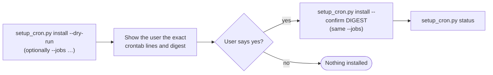

# Scheduled Jobs

What each `setup_cron.py` job does. The rules for installing them — preview with `--dry-run`, show
the user the exact lines and digest, install only with `--confirm <digest>` after a yes — are in
`SKILL.md` (Cron / Automated Playlists) and always apply. A scheduled job runs unattended, so the
one job that writes (weekly mix) is opt-in.

Times are the machine's local time (standard crontab). Each job appends its output to
`~/.apple-music-dj/logs/<job>.log` (owner-only). `python3 {baseDir}/scripts/setup_cron.py list` shows the
same table; `status` shows what is installed; `remove [--jobs …]` undoes it.

| Job | When | Runs | Writes to the account? |
|---|---|---|---|
| `weekly-mix` (opt-in: `--jobs weekly-mix`) | Mondays 7:00 | `strategy_engine.py --strategy trend --create` | **Yes** — creates a playlist each week without asking |
| `new-releases` | Wednesdays 8:00 | `new_releases.sh <profile> <storefront>` | No (report only; no `--create-playlist`) |
| `daily-drop` | Every day 8:30 | `daily_pick.py daily <profile> <storefront>` | No — the pick includes a token-renewal reminder when one is due |
| `health-check` | 1st of each month, 9:00 | `playlist_health.py check all` | No — to fix, run `playlist_health.py fix <id>` (a preview), show it, and add `--apply` only after a yes; `fix` is never scheduled |
| `monthly-drift` (opt-in: `--jobs monthly-drift`) | 2nd of each month, 9:00 | `taste_profiler.py` (saves a dated snapshot), then `taste_drift.py --since 30d --format text` | No |

By default `install` schedules the report-only jobs (`new-releases`, `daily-drop`, `health-check`).

To tell the user about a result (e.g. "🎧 Today's pick: {song} by {artist} — {reason}"), read the
job's log, or schedule the same command through OpenClaw's own cron/heartbeat so its output reaches
the user directly. Apply the same confirm-first rules either way.
