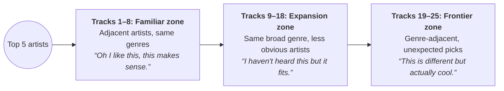
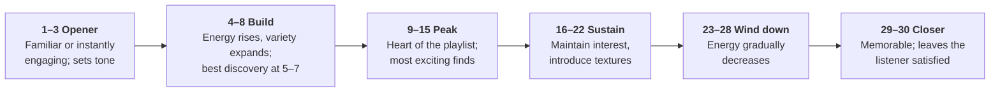
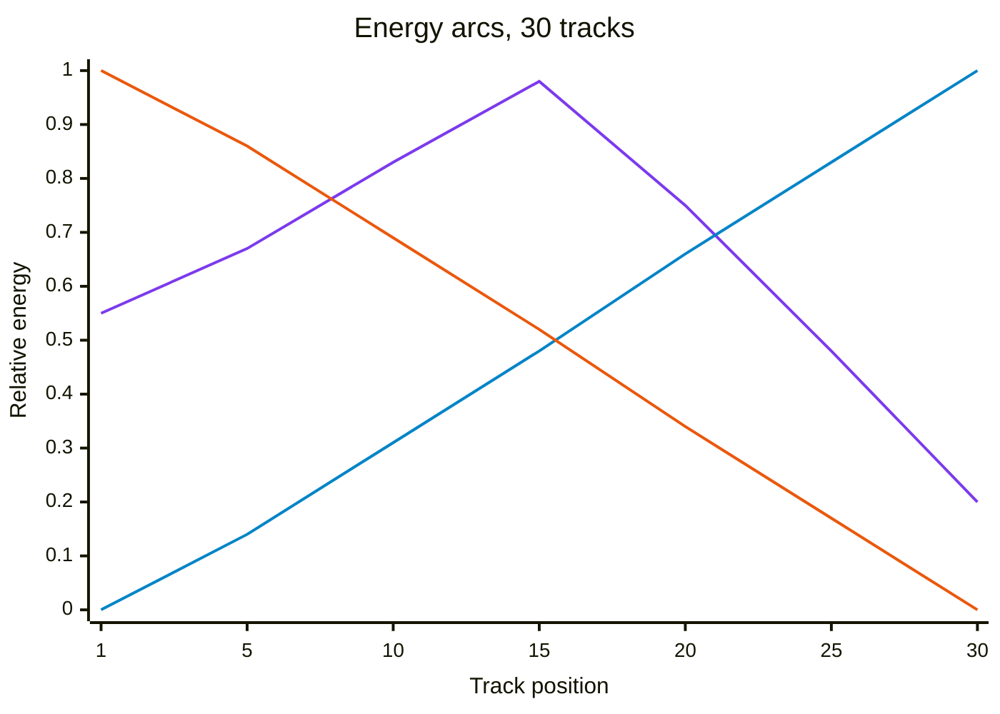

# Playlist Strategies — Deep Reference

## Strategy 1: Deep Cuts Explorer

### Philosophy

Surface tracks the user would love but hasn't found — from artists they already know.
Be the friend who says "have you heard this album track?"

### Algorithm

1. Identify seed artists — top 10–15 from taste profile
2. Fetch full discography for each
3. Fetch "Top Songs" view to identify the obvious hits
4. Filter candidates:
   - EXCLUDE: already in library, recently played, in Top Songs
   - PREFER: album tracks over singles, untouched albums, later tracklist positions
   - PREFER: tracks with features/collaborations, albums with strong critical reception
5. Score and rank, pick 25–35 tracks
6. Sequence for flow

In code: up to 4 random full albums per artist (singles, compilations, live albums and
"greatest hits"/"best of" are skipped); alternate takes such as "(Live)", "(Remix)" or "- Demo"
and the same title on a second release are dropped. Score = 0.5 + min(2 × play weight, 0.3)
+ 0.15 × position in the album (first track 0, last track 0.15), then max 3 tracks per artist.
Scanning stops once there are 3× the target candidates from enough artists to fill the list.

### Naming

- "Deep Cuts · Radiohead & Björk · Feb 2026"
- "Hidden Gems · Your Indie Favorites · Feb 2026"

### Description Template

"Tracks you probably haven't heard from the artists you love. No singles, no greatest hits — just the good stuff hiding in the deep end."

---

## Strategy 2: Mood / Activity Matcher

### Philosophy

Music is functional. This strategy starts from the use case and filters through the user's
taste so it doesn't feel like a generic Spotify editorial playlist.

### Mood → Attribute Mapping

| Mood/Activity | Tempo Feel | Energy | Vocal Style | Genre Lean |
|---|---|---|---|---|
| Workout / Running | 120-160 BPM | High | Anthemic, driving | Electronic, Hip-Hop, Pop, Rock |
| Focus / Study | 80-110 BPM | Low-Med | Minimal/none | Ambient, Lo-fi, Post-rock, Classical |
| Chill / Relax | 70-100 BPM | Low | Soft, breathy | Indie folk, Jazz, Ambient, Acoustic |
| Party | 110-130 BPM | High | Singalong, crowd | Pop, Dance, Hip-Hop, Funk |
| Drive / Road Trip | 100-130 BPM | Med-High | Confident, soaring | Rock, Indie, Alt-country, Pop |
| Sleep / Wind Down | 50-80 BPM | Very Low | Whispered/none | Ambient, Classical, New Age |
| Cooking / Dinner | 90-120 BPM | Medium | Warm, soulful | Jazz, Soul, Bossa nova, Indie |
| Morning / Wake Up | 90-110 BPM | Medium | Uplifting, gentle | Indie pop, Folk, Acoustic |
| Sad / Reflective | 60-90 BPM | Low | Emotional, raw | Singer/songwriter, Indie, Classical |
| Anger / Catharsis | 130-180 BPM | Very High | Aggressive | Metal, Punk, Hard rock |

### Scoring in code

Each mood's energy label maps to a target on `GENRE_ENERGY`'s 0–1 scale (`MOOD_ENERGY`:
very-low 0.1, low 0.25, low-med 0.35, medium 0.5, med-high 0.65, high 0.8, very-high 0.95).
A candidate must share or neighbour a mood genre, then scores

`0.5 × mood-genre match + 0.35 × energy fit + 0.15 × taste match` (+0.1 for your own artists)

where energy fit = 1 − |track energy − target|. A track with energy fit under 0.5 ranks behind
every track that fits, so a sleep mix only reaches for a loud track when nothing quieter is
left. Max 3 tracks per artist.

### Personalization Key

If the user loves indie rock, their "workout" playlist should feature high-energy indie,
not generic EDM. Always cross-reference the mood attributes with the user's genre preferences.

### Activity Sequencing

- **Workout**: warm up (3 tracks) → build (5) → peak (10) → cool down (3)
- **Focus**: steady energy throughout, no jarring transitions
- **Party**: warm up → peak → wind down
- **Sleep**: progressively quieter and slower

### Target Length

25–40 tracks (1.5–2.5 hours) unless specified.

---

## Strategy 3: Trend Radar

### Philosophy

Stay current without losing identity. Everyone gets the same trending playlist — Trend Radar
filters it through the user's unique taste.

### Algorithm

1. Fetch overall top charts for user's storefront
2. Fetch genre-specific charts for user's top 3 genres
3. Score: `taste_match × chart_rank_weight`
   - taste_match: genre overlap + artist proximity to profile
   - chart_rank: higher-ranked gets slight bonus (`1 − 0.3 × rank / chart length`)
4. Remove songs already in library/recently played
5. Add 2–3 wildcards from outside user's genres (expand horizons)
6. Max 3 tracks per artist (wildcards aside)
7. Target: 15–25 tracks

### Genre Filtering

```
GET /v1/catalog/{sf}/charts?types=songs&genre={id}&limit=25
```

Fetch for each top genre, merge, deduplicate.

### Naming

- "Trending For You · Hip-Hop & R&B · Feb 2026"
- "Fresh Picks · Rock & Alt · Feb 2026"

### Description Template

"What's trending right now, filtered through your taste. A few wildcards in there too."

---

## Strategy 4: Constellation Discovery

### Philosophy

Start from familiar territory and gradually pull the listener into new musical space.
Named "Constellation" because it maps outward from known stars to discover new ones nearby.

### Algorithm

1. Take user's top 5 artists from taste profile
2. For each, take Apple's similar artists; when the catalog has none, search with
   `artist name + primary genre terms` (e.g., "Radiohead alternative experimental rock")
3. From results, extract artist IDs NOT in user's library
4. For each discovered artist, fetch their top songs
5. Zone each artist by genre proximity to the user's top 10 genres:
   - 1.0 = exact genre match → familiar
   - 0.5 = same genre family (e.g., Alternative → Rock) → expansion
   - 0.0 = different family → frontier
6. Fill ~30% familiar, ~45% expansion, ~25% frontier; a short zone is backfilled from the
   others (expansion first) so the playlist still reaches its length
7. Build playlist with intentional gradient:



1. The key insight: the familiar opening builds trust, so the user keeps listening
   long enough to reach the discoveries at the end.

### When to Combine

Constellation works well combined with Deep Cuts: "I love Radiohead but I've heard
everything" → Deep cuts from Radiohead catalog + constellation discovery of adjacent
experimental/art-rock artists.

### Naming

- "New Horizons · Beyond Shoegaze · Feb 2026"
- "Constellation · From Radiohead Outward · Feb 2026"

### Description Template

"Starting from the artists you love, this playlist gradually pulls you into new territory.
Stick with it — the best discoveries are toward the end."

---

## Strategy 6: Similar ("songs like X")

### Philosophy

A starting point, not a guess. The user names one artist or song; everything else is
measured against it *and* against their own taste so the result isn't just generic "similar artists".

### Algorithm

1. Resolve the seed (`auto` searches artists and songs together: exact artist-name match wins,
   then a song title match, then the top artist hit)
2. Candidates: the seed artist's top songs; other tracks from a seed song's album;
   top songs of up to 8 similar artists (falls back to a genre search if none are returned)
3. Score = base (seed 0.5, album 0.55, similar 0.3) + 0.6 × genre match to the seed
   + 0.3 × genre match to the user's top genres + 0.1 if the user already loves the artist
   (top artists or recently added)
4. Exclude the seed song, disliked songs, and library songs (unless `--include-library`)
5. Max 3 tracks per artist, then sequence

### Naming

- "Like Radiohead · Oct 2026"

---

## Strategy 7: Era Throwback

### Philosophy

A decade, seen through this listener's ears. Prefer the user's own artists in that decade
over a generic "best of the 90s".

### Algorithm

1. Normalize the decade (`90s`, `'90s`, `1994` → `1990s`); default to the top entry of `era_distribution`
2. Albums by the top 15 artists released in the decade (no singles, max 3 albums each)
3. Charts filtered by release year (mostly useful for the current decade)
4. If still short: search "`<genre> <decade>`" for the top 3 genres, filtered by release year
5. Exclude disliked and library songs (unless `--include-library`); max 3 per artist; sequence

### Naming

- "1990s Throwback · Oct 2026"

---

## Strategy 8: Blend

### Philosophy

A playlist neither listener has to apologize for. Shared favorites anchor it; each person
contributes only what plausibly fits the other's taste.

### Algorithm

1. Compare the two profiles with the compatibility scorer (shared artists, genre overlap)
2. Shared artists' top songs (`source: shared`, highest weight)
3. Each listener's other top artists: keep songs whose genres are exact or family matches for
   the *other* listener's top genres (`source: a` or `b`)
4. A few loved tracks from each profile
5. Cap each listener at 60% of the playlist; drop anything either listener disliked; max 3 per artist

### Naming

- "Blend · Oct 2026" — output also carries the compatibility score and verdict

---

## Sequencing Guide (All Strategies)

### The Arc



### Energy arcs in code

Each track's `energy` (0–1) is the mean of its genres' values in `GENRE_ENERGY` (`_common.py`).
`sequence_tracks(arc=...)` orders by it before applying the hard rules:

- `wave` (default) — medium opener, build, peak in the middle, wind-down
- `ascending` — workout, anger moods
- `descending` — sleep, focus, sad moods
- `none` — keep the incoming order

The shape each arc gives a 30-track playlist. `wave` plots the slot targets `_arc_order` assigns
(opener 0.55, peak 1.0 mid-playlist, closer 0.2; the lowest-energy tracks fill the lowest-target
slots). `ascending` and `descending` simply sort by energy, shown as a straight ramp.



### Hard Rules

- No artist repeat within 5 tracks
- Max 2 songs from same album
- Alternate familiar and unfamiliar artists
- No explicit content unless user's library contains explicit
- Exclude disliked artists (from ratings data)
- End on a strong note, never a filler track

### Your preferences (`~/.apple-music-dj/config.json`)

Every strategy (and the daily pick) reads these optional keys:

| Key | Default | Effect |
|---|---|---|
| `excluded_artists` | `[]` | Never pick these artists (case-insensitive) |
| `preferred_genres` | `[]` | +0.1 to a candidate's score for a matching genre, +0.05 for the same family |
| `avoid_repeat_days` | `30` | Skip tracks used in playlists the DJ created in the last N days (`0` turns it off; not used by the daily pick) |
| `playlist_size` | `30` | Default playlist length |

---

## Concert Prep Strategy

### Philosophy

Get the listener ready for a live show. They should know the hits (likely setlist material)
AND have a few deep cuts in their pocket so they appreciate the full performance.

### Algorithm

1. Search for the artist by name
2. Fetch top songs (15 tracks — these are the probable setlist core)
3. Fetch discography → extract album tracks NOT in top songs (deep cuts)
4. Take up to 10 deep cuts
5. Sequence: top songs first (what they'll hear live), deep cuts after (context)
6. Create playlist with descriptive name: "Concert Prep · {Artist} · {Mon YYYY}"

### Sequencing

- Tracks 1–15: Top songs / setlist material (high confidence)
- Tracks 16–25: Deep cuts to build familiarity with the full catalog
- Opener should be the artist's most recognizable track

### Naming

- "Concert Prep · Phoebe Bridgers · Feb 2026"

### Description Template

"Get ready for {artist} live. {N} essential tracks + {M} deep cuts to know before the show."

---

## Daily Song Drop Strategy

### Philosophy

One song, one reason, zero friction. The best daily engagement is the simplest.
The user opens their day with a single track that feels hand-picked.

### Algorithm

1. Use date-based seed for deterministic daily selection
2. Source candidates from:
   - Deep cuts from top artists (tracks NOT in library)
   - Trending tracks matching user's genre preferences
3. Score each candidate:
   - Deep cuts get a slight boost (more interesting picks)
   - Time-of-day genre matching (morning → gentle, evening → energetic)
   - Random factor for variety
4. Select from top-scoring tier

### What Should I Listen To Right Now? (instant variant)

Same algorithm but adds strong time-of-day weighting:

| Time | Period | Energy | Genre Boost |
|---|---|---|---|
| 5–9 AM | Morning | Medium | Indie Pop, Folk, Acoustic |
| 9–12 PM | Mid-morning | Med-High | Alternative, Indie, Electronic |
| 12–2 PM | Midday | Medium | Pop, R&B/Soul, Jazz |
| 2–5 PM | Afternoon | Med-High | Rock, Indie, Hip-Hop |
| 5–8 PM | Evening | High | Pop, Dance, Rock, Hip-Hop |
| 8–11 PM | Night | Med-Low | Ambient, Jazz, Singer/Songwriter |
| 11 PM–5 AM | Late Night | Low | Ambient, Classical, Lo-fi |

### Naming

Daily drop has no playlist — it's a single track recommendation.
The "now" variant also returns just one track with context.

---

## New Release Radar Strategy

### Philosophy

Stay current without losing identity. Go beyond just "your artists" — also surface
genre-adjacent new releases the user would never find on their own.

### Algorithm

1. Extract top 20 artists from taste profile
2. For each, fetch recent albums (last 7 days)
3. Also search for new releases in user's top 3 genres
4. Deduplicate by album ID
5. Optionally: create a playlist with one track from each new release

### Naming

- "New Releases · Feb 24, 2026"

### Description Template

"Fresh releases from your artists and genre discoveries. {N} tracks."
